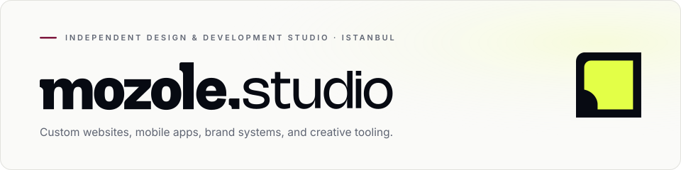

<picture>
  <source media="(prefers-color-scheme: dark)" srcset="https://raw.githubusercontent.com/MozoleStudio/.github/main/profile/banner-dark.svg" />
  <source media="(prefers-color-scheme: light)" srcset="https://raw.githubusercontent.com/MozoleStudio/.github/main/profile/banner-light.svg" />
  
</picture>

 

**Mozole Studio** is an Istanbul-based independent digital product studio building thoughtful software, cohesive design systems, and creative tooling for web and mobile.

### Focus Areas

* **Digital Products** — Native and cross-platform experiences built around clarity, speed, and tactile interaction.
* **Design Systems** — Unified visual languages, typography, color foundations, and component contracts across surfaces.
* **Creative & AI Workflows** — Specialized tooling for media pipelines, automation, and editorial production.

---

[mozole.studio](https://mozole.studio) · [@mozolestudio](https://x.com/mozolestudio) · [mozole.studio@protonmail.com](mailto:mozole.studio@protonmail.com)
